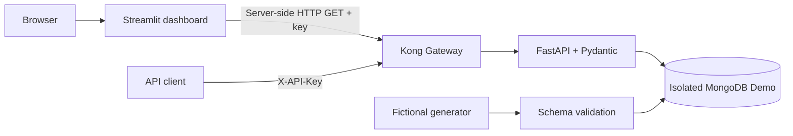
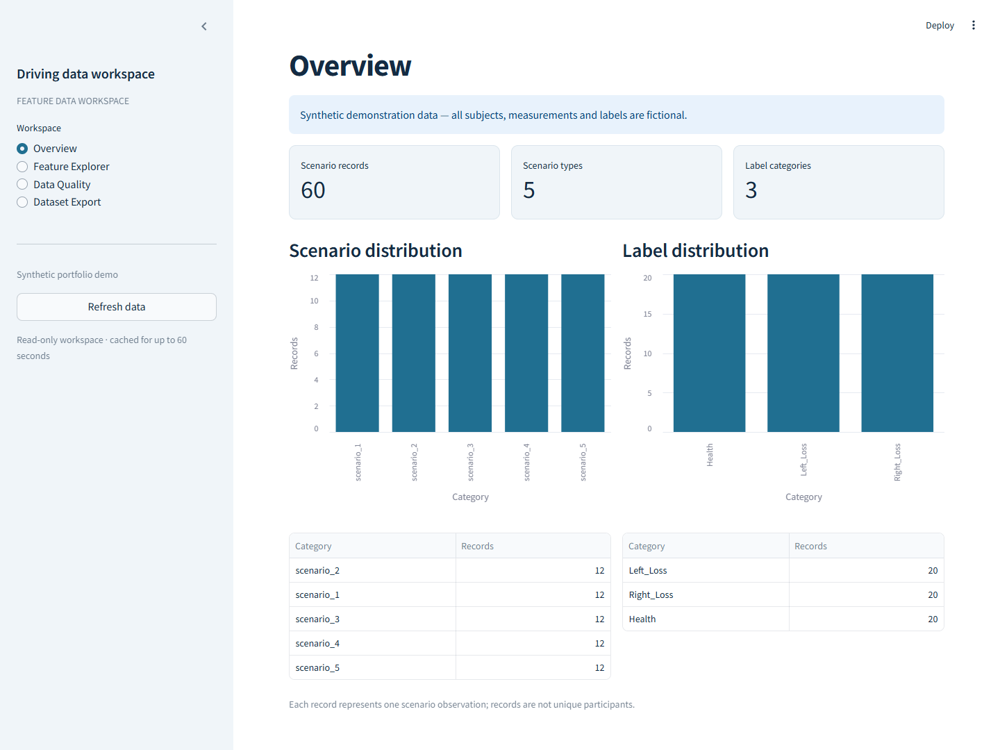

# Driving Simulator Physiological Data Management & Processing

A lightweight Data Engineering portfolio project for storing, validating, exploring and exporting multimodal driving-simulator features. The public Demo uses **60 entirely fictional observations** across five scenarios. No participant records, raw recordings or research exports are distributed.

Suggested repository name: `driving-simulator-physio-data`.

## Quick start

Requirements: Docker Desktop in Linux-container mode and Python 3.9+ for the credential setup helper.

```powershell
python scripts/setup_demo.py
docker compose --env-file .env.demo -f compose.demo.yaml -p driving-simulator-demo up -d --build --wait
docker compose --env-file .env.demo -f compose.demo.yaml -p driving-simulator-demo ps
```

- Dashboard: **http://localhost:18501**
- Swagger/OpenAPI: **http://localhost:18000/docs**
- Health: **http://localhost:18000/health**

The helper creates an ignored `.env.demo` with new random Demo credentials. It never opens or overwrites `.env`. Existing `.env.demo` files are preserved. The explicit `--env-file` and `-f` options are required: do not substitute private local Compose files or environment files.

The project name is `driving-simulator-demo`; its dedicated volume is `driving-simulator-demo_synthetic_mongodb_data`. MongoDB and FastAPI have no published host ports. API/dashboard ports bind to localhost only. Startup generates and validates fictional fixtures, then inserts missing fixture IDs without overwriting existing Demo edits. Nothing loads data from local research directories.

## Architecture and stack



Python, FastAPI, Pydantic, PyMongo, MongoDB, Kong DB-less mode, Streamlit, Pandas, NumPy, Docker Compose and pytest form the four-service stack. Streamlit never connects directly to MongoDB and never sends API keys to browser code.

## Capabilities

- Deterministic synthetic feature initialization and indexed MongoDB storage.
- Validated feature creation, duplicate detection and partial updates.
- Patient/scenario/label filters, pagination, single-record queries and statistics.
- Flat CSV export preserving feature names and missing values.
- Dashboard pages: **Overview**, **Feature Explorer**, **Data Quality**, **Dataset Export**.
- Kong header-based API keys, per-consumer rate limits, and a disabled Admin API.

Feature families cover ECG, EDA, EEG, eye tracking, head movement, simulator behavior and questionnaire attributes. The Demo measurements are generated independently using simple deterministic mathematical patterns; they are not copied from participants and are not clinically validated.

## Processing and data model

The public workflow is fictional generation ? schema validation ? idempotent insertion ? API validation/query ? missingness and modality profiling ? CSV export. Each MongoDB document is one scenario observation, with a string `_id`, fictional `patient_id`, `scenario`, `label`, numerical `features`, provenance and import timestamps. Dotted feature names remain literal keys.

The existing normalization helpers convert NumPy/Pandas values for BSON storage. Dashboard quality calculations distinguish missing cells, invalid numbers and modality availability. Simulator availability excludes scenario 5 by contract. Missingness can reflect scenario-specific fields and is not a clinical quality score.

Private raw-signal extraction adapters, participant labels, spreadsheets and historical outputs are deliberately excluded from this public release. This Demo does not ingest raw sensor data or train machine-learning models.

## API

| Method | Path | Behavior |
| --- | --- | --- |
| GET | `/health` | Public database health check |
| GET | `/api/v1/features` | Filters and `limit`/`offset` pagination |
| GET | `/api/v1/features/{id}` | One record |
| POST | `/api/v1/features` | Create a fictional observation; reject duplicates |
| PATCH | `/api/v1/features/{id}` | Update selected feature values and/or label |
| GET | `/api/v1/features/export` | Filtered Pandas-compatible CSV |
| GET | `/api/v1/patients/{patient_id}/features` | Patient-filtered pagination |
| GET | `/api/v1/scenarios/{scenario_type}/features` | Scenario-filtered pagination |
| GET | `/api/v1/stats` | Scenario and label counts |
| GET | `/api/v1/demo/features` | Fixed fictional fixture reference |

Open Swagger, click **Authorize**, and enter the Demo API key from `.env.demo`. All `/api/v1` endpoints require `X-API-Key`; `/health` and API documentation are public. Demo-created patient codes must use `P99-...`.

```powershell
$demo = Get-Content .env.demo -Raw | ConvertFrom-StringData
curl.exe -H "X-API-Key: $($demo.DEMO_API_KEY)" "http://localhost:18000/api/v1/features?scenario=scenario_1&limit=2"
curl.exe -H "X-API-Key: $($demo.DEMO_API_KEY)" "http://localhost:18000/api/v1/features/export?label=Health" -o fictional_features.csv
```

A list response contains `total`, `limit`, `offset`, and `items`. Invalid input returns 422, missing records 404, duplicates 409, unavailable MongoDB 503, missing/invalid keys 401, and exhausted rate limits 429. See [API examples and Postman setup](docs/api.md).

## Dashboard and screenshots

Overview shows record and category counts. Feature Explorer provides filters, pagination and feature details. Data Quality shows cell missingness and modality coverage. Dataset Export selects feature groups and downloads a flat CSV without original source IDs. All public views display a fictional-data banner.



[All pages, walkthrough and screenshot instructions](docs/dashboard.md).

## Tests and release checks

```powershell
python -m pip install -r requirements-dev.txt
python -m pytest -q
$env:RUN_DEMO_TESTS = '1'
$env:RUN_DASHBOARD_TESTS = '1'
$env:RUN_KONG_TESTS = '1'
python -m pytest -q
python scripts/audit_release.py
```

Offline tests use synthetic fixtures and mocked MongoDB. Integration tests use only the isolated Demo and remove only their own fictional test record. Gateway tests intentionally exhaust the shared minute bucket; wait for `Retry-After` before further requests. Optional browser checks and synthetic screenshots are described in the dashboard guide.

## Security, limits and next steps

Private data, local environments, exports, backups, caches and obsolete tools are excluded by an allowlist and reviewed before staging. Demo containers mount only the new synthetic volume. The Demo ignores private MongoDB URI overrides and fails closed on a non-demo database selection. Never share `.env.demo`, credentials, Docker environment dumps or private files.

This is a localhost portfolio application, not a production clinical system. One shared API key can create/update Demo records; the dashboard is read-only. Rate limits are in-memory on one Kong instance. CSV profiling/export materializes data in memory. No clinical validation, model training, TLS termination or user-level authorization is claimed. Future improvements include per-user authorization, streaming exports, dependency locking and richer data contracts.

See [architecture](docs/architecture.md), [security](docs/security.md), [Kong configuration](docs/kong.md), and [release verification](docs/release-report.md). **License decision pending.** No open-source license is granted by this repository yet.
