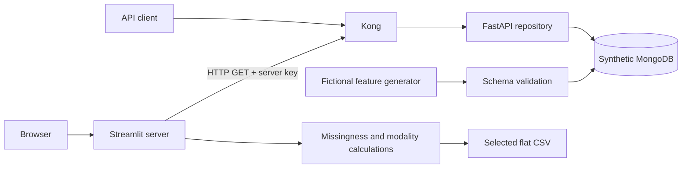

# Architecture

The public application retains four services: MongoDB, FastAPI, Kong Gateway and Streamlit.

- **MongoDB:** dedicated `driving_features_demo.scenario_features` storage in the project-scoped synthetic volume. No host port is published.
- **FastAPI:** startup validation/idempotent seeding, Pydantic validation, feature CRUD, pagination, statistics and CSV export. It joins the internal database network and the application network.
- **Kong:** DB-less declarative routing, header API keys and local per-consumer rate limiting. Admin API disabled. Only its localhost proxy port is published.
- **Streamlit:** server-side HTTP client to Kong. It receives no database credentials and has no MongoDB driver. Browser views and downloads omit source record/participant IDs.

The initializer imports no local recordings, spreadsheets, labels or old exports. It derives 60 observations from deterministic fictional patterns. MongoDB upserts use `$setOnInsert`, so repeated startup creates only missing fixture IDs and preserves Demo edits.

Requests to normal API routes use only the dedicated Demo database. Demo configuration ignores private connection overrides and rejects a different database name. MongoDB's network is internal and its volume is distinct from any local research workflow. There are no background jobs or raw-sensor ingestion services in this release.

Processing consists of schema/BSON normalization, indexed record storage, validated API updates, quality profiling and filtered export. Original private signal-processing adapters are not distributed or invoked. See the security guide for isolation boundaries and limitations.
